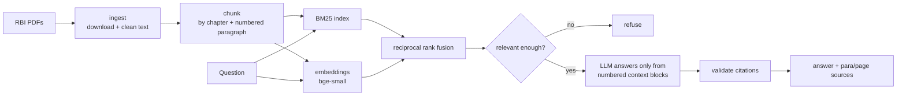

# RegLens

Ask questions about RBI Master Directions and get answers with citations to the exact paragraph.

[](https://github.com/RB6339/reglens/actions)
  

**[▶ Live demo](https://huggingface.co/spaces/RB6339/reglens)**: paragraph search with citations, running in the browser on Hugging Face Spaces.

```
Q: How often should KYC be updated for high risk customers?
A: ... at least once every two years for high risk customers ... [1]

Sources:
  [1] Know Your Customer (KYC) Directions, 2025, para 42, p. 41
```

## Why

RBI regulations (KYC, cards, interest rates, customer conduct) are long PDFs that get updated often. Finding "what does RBI say about X" usually means Ctrl+F across hundreds of pages. RegLens is a RAG (retrieval-augmented generation) app that answers these questions, always points back to the source paragraph, and says so when the documents don't cover the question instead of guessing.

## How it works



- **Paragraph-level chunks.** RBI directions are numbered paragraph by paragraph and grouped into chapters, so chunks follow those boundaries instead of fixed windows. Every chunk carries `source, chapter, para, page_start, page_end`, which is what makes citations like "para 42, p. 41" possible. Long paragraphs are split at sub-items `(1)`, `(a)`, `(xix)`, and table-of-contents lines are skipped.
- **Hybrid retrieval.** BM25 handles exact regulatory terms ("V-CIP", "Officially Valid Document"); embeddings handle paraphrases ("redo KYC" vs "periodic updation"). Reciprocal rank fusion merges both without calibrating their scores.
- **Grounded answers.** The LLM sees numbered context blocks and must cite them. Citations pointing to blocks that don't exist are dropped, and an answer with no valid citation is turned into a refusal.
- **Refusal.** If the best BM25 match is weak, RegLens refuses without calling the LLM. If the LLM decides the blocks don't answer the question, it refuses too.

## Quickstart

```bash
git clone https://github.com/RB6339/reglens && cd reglens
python -m venv .venv && source .venv/bin/activate
pip install -e ".[api,llm,dev]"          # add ,dense for embeddings / hybrid search
```

`data/chunks.jsonl` (KYC Directions) is included, so search works right away. To rebuild it or add the other directions in `configs/sources.yaml`:

```bash
python -m reglens.ingest     # download + extract PDFs -> data/processed/
python -m reglens.chunk      # paragraph chunks -> data/chunks.jsonl
```

### Search (no API key needed)

```bash
python -m reglens.search "how often should KYC be updated for high risk customers"
python -m reglens.search --mode hybrid "how often do I need to redo KYC"   # needs .[dense]
```

### Ask (needs an LLM)

Any OpenAI-compatible API works (OpenAI, Groq, OpenRouter, local Ollama):

```bash
export OPENAI_API_KEY=...                 # optional: OPENAI_BASE_URL, REGLENS_MODEL (default gpt-4o-mini)
python -m reglens.ask "What documents are needed to open an account for a partnership firm?"
```

### API + web page

```bash
uvicorn reglens.api:app --port 8000
# http://localhost:8000        simple Ask / Search page
# http://localhost:8000/docs   Swagger
```

| Endpoint | What it does |
|---|---|
| `GET /health` | status, number of chunks, whether an LLM is configured |
| `POST /search` | `{"query": "...", "k": 5}` → ranked paragraphs with citations |
| `POST /ask` | `{"question": "..."}` → answer, citations, `refused` flag |

### Docker

```bash
docker build -t reglens .
docker run -p 8000:8000 -e OPENAI_API_KEY=$OPENAI_API_KEY reglens
```

## Evaluation

`eval/kyc_questions.jsonl` has 35 questions: 30 labelled with the paragraph(s) that answer them, and 5 out-of-scope questions (repo rate, gold loan LTV, ...) that should be refused.

```bash
python -m reglens.evaluate                   # retrieval metrics
python -m reglens.evaluate --answers         # + refusal accuracy and citation check with the LLM
```

Retrieval on the KYC Directions (BM25, k=5):

| Metric | Score |
|---|---|
| hit@1 | 0.967 |
| hit@5 | 1.000 |
| MRR | 0.983 |

Honest caveat: these questions were written while reading the paragraphs, so their wording overlaps with the source text, which favours BM25. A harder set of paraphrased questions is the next step, and it is where dense and hybrid modes should matter.

## Tests

```bash
pytest -q        # 26 tests, no network or API key needed
ruff check .
```

Tests cover PDF text cleaning, chunking (paragraph and chapter detection, TOC skipping, unique ids), BM25, dense and hybrid search (with a fake encoder), answer generation (with a fake LLM: citation validation and refusals), the API and the evaluation metrics. CI also builds the Docker image and smoke-tests `/health` and `/search`.

## Project structure

```
configs/sources.yaml        RBI directions to ingest
src/reglens/
  ingest.py                 download + extract + clean PDF text
  chunk.py                  chapter / paragraph-aware chunking
  retrieve.py               BM25
  dense.py                  embeddings, hybrid search (RRF)
  answer.py                 grounded answers, citation validation, refusal
  evaluate.py               retrieval + answer metrics
  api.py, static/           FastAPI + web page
  search.py, ask.py         CLIs
eval/kyc_questions.jsonl    labelled question set
```

## Plan

- [x] Download + parse RBI Master Direction PDFs
- [x] Section-aware chunking with metadata (direction, chapter, paragraph number)
- [x] Retrieval (BM25 + embeddings, hybrid with reciprocal rank fusion)
- [x] Answers with citations, refuse when the documents don't cover the question
- [x] Evaluation set (retrieval hit rate, refusal accuracy, citation check)
- [x] FastAPI + simple UI
- [ ] Deploy (AWS)
- [ ] Paraphrased evaluation set, compare bm25 / dense / hybrid

## Disclaimer

Not legal or compliance advice. Always check the latest version of the direction on [rbi.org.in](https://www.rbi.org.in/Scripts/BS_ViewMasterDirections.aspx).

## License

MIT
